# Architecture diagrams: the big picture

Maps of the whole system for someone who has not read the code yet: what runs where, how the code is layered, what one turn of the agent does, and the flows where a mistake would leak data, spend money or write twice.

A diagram is a map, not the contract. The text under each one names the code that is the contract, and the other docs hold the reasoning: [ARCHITECTURE.md](ARCHITECTURE.md) (the layering and the tests that enforce it), [GRAPH_PATTERNS.md](GRAPH_PATTERNS.md) (the graph; each pattern has the bug behind it), [COST_GOVERNANCE.md](COST_GOVERNANCE.md) and the [constitution](.specify/memory/constitution.md). Checked against the code on 2026-11-10. When a diagram and the code disagree, the code is right, and a change that alters a flow fixes its diagram.

| You want to know | Read |
|---|---|
| Which processes exist and who talks to whom | [1](#1-runtime-topology) |
| How the code is layered, and what may import what | [2](#2-the-rings-ports-and-adapters), [3](#3-the-engine-and-its-domain-modules) |
| What one turn of the agent does, node by node | [4](#4-the-agent-graph) |
| Where each piece of state lives | [5](#5-where-state-lives) |
| Where the three non-negotiable rules are enforced | [6](#6-where-the-non-negotiable-rules-are-enforced) |
| How it is built, shipped and run | [7](#7-deployment-and-delivery) |
| A request from click to answer | [8](#8-a-chat-turn-end-to-end), [9](#9-signing-in-and-crossing-the-front-door) |
| Approval, and why a write happens once | [10](#10-human-approval-pause-decide-resume), [11](#11-a-write-tool-runs-exactly-once) |
| What happens when a worker dies | [12](#12-a-worker-dies-mid-turn) |
| Retrieval, cost, skills and subagents, uploads, MCP, start-up | [13](#13-retrieval-hybrid-search-under-a-tenant-scope) to [18](#18-process-start-wire-and-the-graph) |

## Part 1: Structure

### 1. Runtime topology

The processes and how a request reaches them. Every chat client, the web UI, the CLI and Telegram alike, goes through the front door and the queue; nothing runs the graph inside a client's process and nothing but the API writes to the queue (patterns 89 and 91). The MCP gateway is the one other way in, and it only reads. Which process touches which store is in [section 5](#5-where-state-lives).

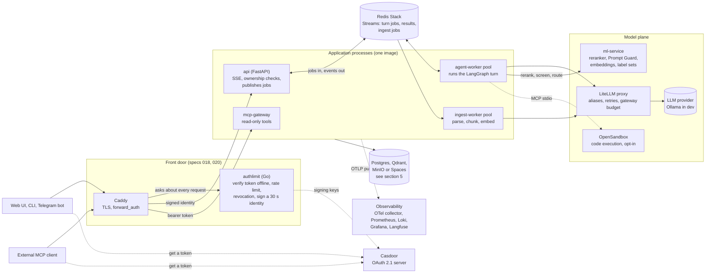

- The API and the workers share no memory, only Redis and Postgres, so the tier that holds SSE connections and the tier that runs turns scale on their own (pattern 43).
- The production compose file ships `api`, `agent-worker`, `ingest-worker`, PgBouncer, Postgres, Redis, Qdrant, LiteLLM and `ml-service` behind Caddy. Casdoor, the MCP gateway, Langfuse, MinIO, crawl4ai and OpenSandbox are in the dev stack only, and the production Caddyfile is not yet wired to authlimit ([README](README.md#-deploying-to-production)).
- The README's [architecture diagram](README.md#-architecture) draws the same system at node level, including the upload pipeline.

### 2. The rings: ports and adapters

The application reaches every outside system through a `Protocol` (a port), and one module, `app/bootstrap.py`, joins each port to its adapter when a process starts. The arrows are the only legal import directions.

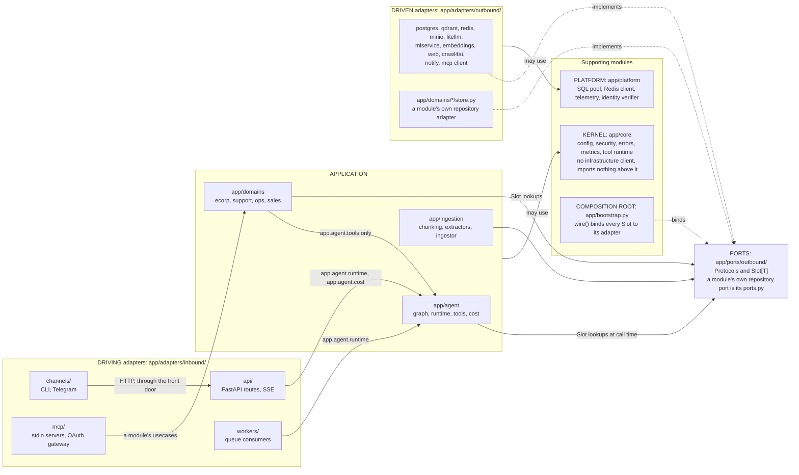

- **Inbound adapters are leaves**: nothing in `app/` imports them, and an inbound adapter never imports an outbound one (it goes through a port, its own technology, or `app/platform`).
- **A module imports no other module.** What two modules share goes in `app/domains/shared/`; code outside `app/domains/` imports only a module's `domain` and `usecases`.
- **No infrastructure client** (`psycopg`, `redis`, `qdrant_client`, `httpx`, ...) in the application ring; a module's own `store.py` is its adapter and is the exception. A slot with no adapter raises `PortNotBoundError` naming the port.
- **Only an entrypoint imports `app.bootstrap`**, and every entrypoint calls `wire()` first.

Each rule is a test in `tests/core/test_architecture_layers.py` or `tests/core/test_entrypoints_wire.py`; [ARCHITECTURE.md](ARCHITECTURE.md) has the full catalogue and how to add a port.

### 3. The engine and its domain modules

`app/agent` is the one engine; a business feature is a module that plugs into it. A new use case is a manifest and a plugin, never a fork of `build_graph()` (pattern 23). The engine has two doors, one for modules and one for adapters.

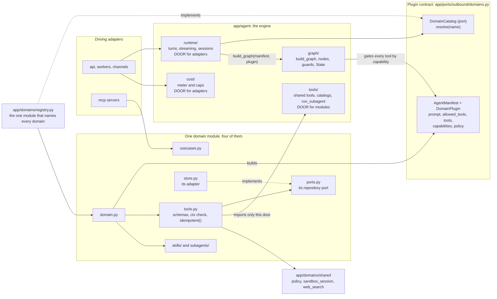

- A module's `AgentManifest.allowed_tools` is an exact list: that omission, not a policy check, is what "sandboxed" means for a domain.
- Each skill (`skills/<name>/SKILL.md`) and subagent (`subagents/<name>/AGENT.md`) lives in its domain's folder, so the folder is the owner and a domain never sees another's.
- The runtime builds one compiled graph per served domain over a single shared checkpointer (`app/agent/runtime/core.py::init_graph_async`).

### 4. The agent graph

One turn is one walk through this state machine, 20 nodes in all, drawn here in two halves that meet at `agent` and `check_output`. The refusal exits are first-class: a turn that cannot be answered ends with a named reason, not a silent truncation. Dashed nodes end the turn.

**First half: the entry gates.** Nothing that spends runs until a turn has passed these.

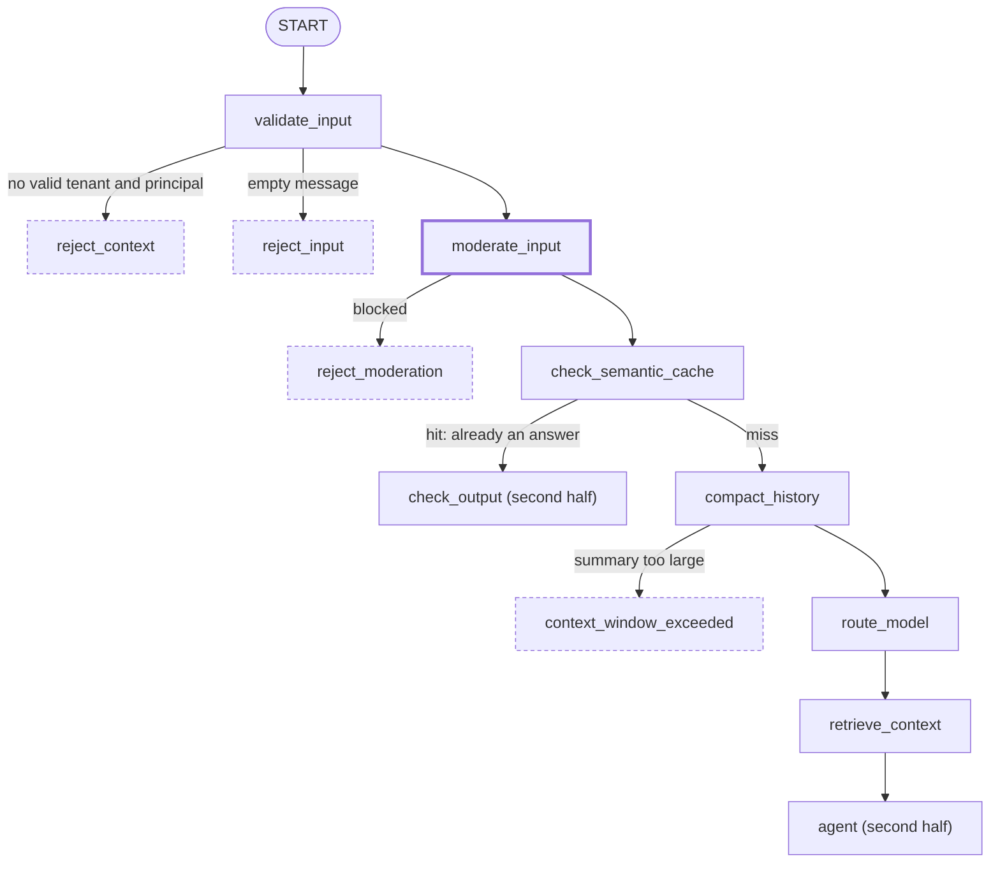

**Second half: the agent loop and the output gate.**

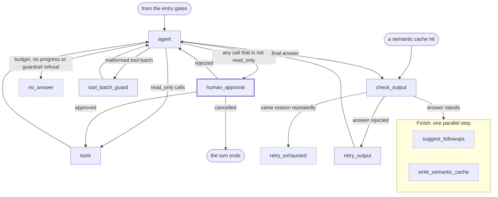

- **Order is cost order.** Moderation runs before anything that spends, the cache before compaction (an LLM call), compaction before the router, so a refused or cached turn pays for none of them (patterns 25, 22, 41, 68).
- **`should_continue` checks the budgets first**, whatever the model said: iterations, tokens, dollars and repeated identical calls all end in `no_answer` (patterns 10, 34, 35). Anything not `read_only` goes to `human_approval` and no flag skips it (patterns 8, 15).
- **`check_output` is a registry of checks** (leaked prompt, too short, fabricated, uncited, a skipped required tool, ...), and `retry_output` loops back to `agent` with a corrective message tagged as a retry artifact so it is never mistaken for the person's words (pattern 5).
- **The two finish steps run in parallel**, and the cache write is skipped when the turn called a non-read-only tool (pattern 22).
- A nested `run_subagent` run builds the same graph with `SUBAGENT_PROFILE`: no cache pair, follow-ups, compaction or router. `GraphProfile` is in `app/agent/graph/build.py`.
- The full routing detail, with every dead end, is in [GRAPH_PATTERNS.md](GRAPH_PATTERNS.md#graph-flow).

### 5. Where state lives

A turn keeps nothing in process memory, which is why any worker can take any job and a dead worker's turn can be continued. A table says this more precisely than a diagram with a line from every process to every store.

| Store | What lives there | Written by | Read by |
|---|---|---|---|
| Postgres `checkpointer` | LangGraph's saved state: the conversation, and any approval pause | agent-worker | agent-worker, api (session reads) |
| Postgres `appdata` | `chat_sessions` (who owns a thread), `tool_call_dedup`, `usage_events`, budget holds and policies, each domain's tables, the billing tables | api (thread claim), agent-worker (ledger, events, holds, domain writes) | api (`GET /usage`), agent-worker, mcp-gateway |
| Redis Streams | `agent:requests:<domain>` jobs, `agent:results:<request_id>` events (5 minute TTL), `:dead` dead letters, `ingest:requests`, `ingest:results:<job_id>` | api (requests), workers (results) | workers (requests), api (results) |
| Redis plain keys | `agent:lock:<thread>`, `agent:cancel:<thread>`, `chat:submit_dedup:...`, Telegram's update list and poll offset | agent-worker (lock), api (cancel flag, dedup claim), the bot | the same |
| Redis semantic cache | a RediSearch vector index, keyed by tenant and principal | agent-worker (the finish step) | agent-worker (the cache check) |
| Redis limiter state | token buckets, the revocation list | authlimit | authlimit |
| Qdrant | documents and memories in one collection, told apart by a `kind` field; a separate skills collection. A collection's name carries the embedding identity of its vectors | ingest-worker (documents), agent-worker (memories, through the approved `remember` tool), `make index-skills` | agent-worker |
| MinIO or Spaces | uploaded files, as `<tenant>/<job_id>-<filename>` | api | ingest-worker |

- **Two Postgres databases, on purpose.** `checkpointer` is what makes an approval pause survive a restart; `appdata` is everything the application queries. Both are reached through PgBouncer in transaction mode, so no pool uses prepared statements (`tests/core/test_pooler_safe_sql.py`).
- **One Redis, three jobs**: Streams for the queues, a vector index for the semantic cache, plain keys for locks and flags. The names the producer and the consumer must agree on are plain data in `app/ports/outbound/jobs.py`.
- **A Qdrant collection records the embedding model its vectors were made with** (model, size, prefixes, revision) and the app refuses to mix two (pattern 67).

### 6. Where the non-negotiable rules are enforced

Three principles in the [constitution](.specify/memory/constitution.md) cannot be waived: I tenant isolation, II mandatory approval, IV exactly-once. Each is held by several independent layers, each closing a failure the one before it cannot see.

| Principle | The layers, outermost first |
|---|---|
| **I. Tenant isolation** fails closed | The caller is the front door's signed identity, and `X-Tenant-Id` is ignored in `identity` mode (`app/adapters/inbound/api/deps.py::get_ctx`). A thread belongs to whoever sent on it first, and anyone else gets the 404 an unknown id gets (`app/adapters/inbound/api/routers/chat.py::_require_conversation_owner`). `SecurityCtx` is stamped from request config, never from message text, and every tool re-checks it (`app/core/tool_runtime.py::ctx_or_refuse`). `Policy.lower` turns it into an `AccessScope` that the store applies inside the query as a pre-filter (`app/adapters/outbound/qdrant/qdrant_store.py::scope_filter`, `WHERE tenant = %s`), never as a Python filter afterwards |
| **II. Approval** is mandatory | Every tool declares `read_only`, `mutating` or `outward`, and an undeclared one counts as `outward`. `should_continue` routes any non-`read_only` call to `human_approval`, which pauses with `interrupt()` and persists the pause in the checkpoint (`app/agent/graph/routing.py::should_continue`, `app/agent/graph/hitl.py::make_human_approval_node`). Unattended callers decline and never approve; subagents get `read_only` tools only; the routing model can write `State.model_route` and nothing else |
| **IV. Exactly-once** side effects | `idempotent()` claims the `tool_call_id` before a write runs (`app/core/tool_idempotency.py::idempotent`). The domain store backs it with `tool_call_id UNIQUE` and `ON CONFLICT DO NOTHING`. A crashed turn is continued from its checkpoint, never restarted, so no new ids are minted. A timeout tells the agent to verify before retrying. A resubmitted request is deduplicated at the API |

The others, briefly: **III** tools are fixed and typed, with closed vocabularies and ids derived by code (no text-to-SQL); **V** failure is bounded by nine independent budgets and every degrade path is counted; **VI** retrieved or crawled text is framed as data, never instructions (`app/core/untrusted.py::frame_untrusted`).

### 7. Deployment and delivery

How a change reaches a running system. Creating or destroying droplets is always a human-run `terraform apply`; everything after a merge is automatic.

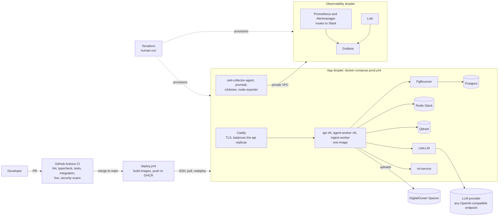

- **The same code runs in dev and prod**; only configuration and the compose file differ ([README](README.md#-environments)).
- **Schema changes are not applied by the deploy.** `postgres-init/*.sql` runs on a fresh volume only; the billing scripts have their own `make billing-migrate`, which runs before the code that needs them ([README](README.md#database-migrations)).
- **A graph change needs the workers drained first**: a renamed router or node can hide a mid-flight turn's pending node (pattern 16). The runbook is [deploy/README.md](deploy/README.md).

## Part 2: Flows

Reading the sequence diagrams: a numbered arrow is a call or a message; `Note` lines carry the rule that makes the step safe; `alt` branches are the failure and degrade paths, which is where most of the design lives.

### 8. A chat turn, end to end

The path every turn takes, whichever client sent it. The API never runs the graph: it publishes a job and relays the worker's events as SSE.

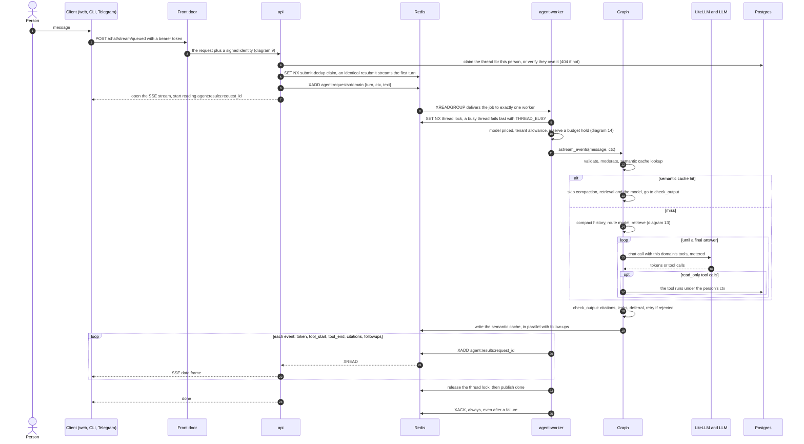

- **The lock is released before the terminal event is published**, not after. A client that sees `done` or `approval_required` may fire the next request at once: releasing only after the handler returned rejected about a third of resumes as `THREAD_BUSY`, and releasing right after the publish still rejected about one in eight (`app/adapters/inbound/workers/agent_worker.py::process_request`).
- **A job is always acked**, even on failure: a redelivered, already-attempted job would re-run side effects. A worker that dies before the ack is the reclaim path (diagram 12).
- The first-event deadline turns "no worker is running" into an `error` event instead of an SSE connection that hangs.

### 9. Signing in and crossing the front door

Identity is proven once at the edge and handed on as a short-lived signed assertion. The API trusts nothing a client sends about who it is.

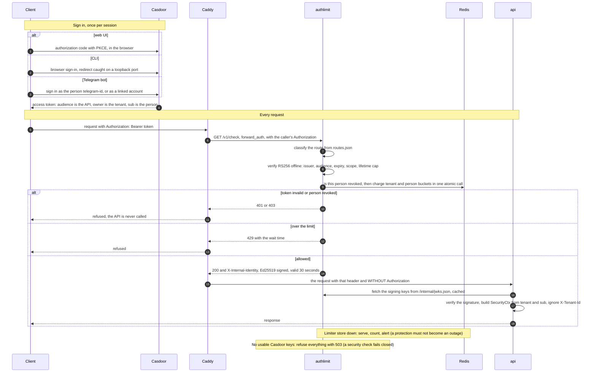

- **Fail closed where it is a check, open where it is a protection.** No usable signing keys or an untrustworthy revocation list is a 503; a Redis outage for the limiter is served and alerted. The API likewise answers 503, never a guess, when it cannot confirm its keys (pattern 86).
- Route classes (`services/authlimit/routes.json`): a turn and an upload are verified and limited; cancel and reads are verified and not limited; `/health` and the web page are public; the two MCP routes are limit-only.
- The CLI and Telegram are clients of this same path (spec 020): they never touch the queue or the graph (`tests/adapters/inbound/channels/test_channels_use_the_door.py`).

### 10. Human approval: pause, decide, resume

The pause is a checkpoint, not a held connection, so it survives a restart and any worker can resume it. The decision is a separate request with its own results stream.

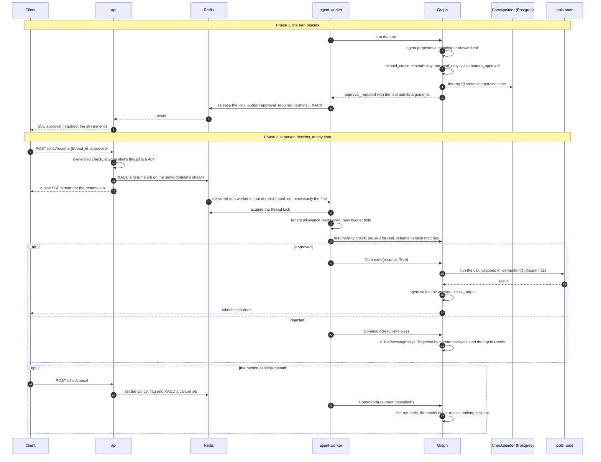

- **A new message on a paused thread is refused** with `PENDING_APPROVAL`; it is never auto-cancelled, because the pending call is by construction a write the person may not know about (`app/agent/runtime/stream.py::astream_events_turn`).
- **Cancel is a third outcome, not a rejection.** A rejection hands the model a message to react to; a cancel ends the run (pattern 36). It is never gated by the budget, so an over-budget tenant can always clear a paused thread.
- **Unattended callers** (Telegram with approvals off, queue jobs) decline up to a bounded number of pauses, then cancel; nothing ever approves on their behalf (pattern 8). With Telegram buttons only the tap of the person the buttons were shown to approves, once, in time (pattern 92).

### 11. A write tool runs exactly once

Approval says a write may happen; this says it happens once, however many times the call is replayed (a reclaimed resume, a crash, a retry).

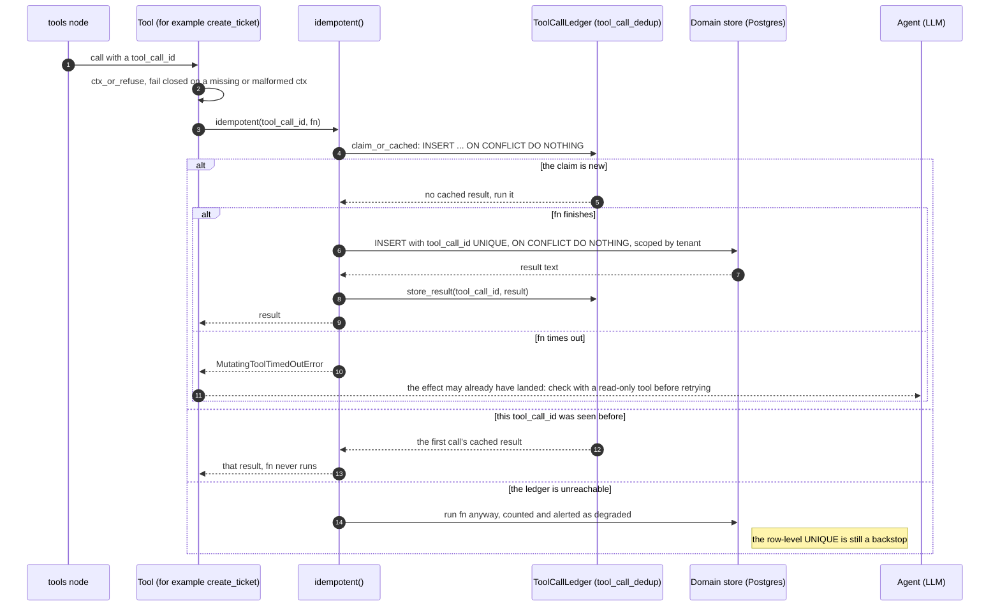

- **The ledger is keyed by `tool_call_id`**, which the provider issues fresh per call, so two invocations with the same id are one invocation attempted again. It makes one invocation exactly-once, and nothing more: a whole turn re-run from scratch would get new ids, which is why a crashed turn is continued (diagram 12) rather than restarted.
- **It fails open on purpose**: a dedup outage must not block every write, and the schema's own uniqueness is the second line (`app/core/tool_idempotency.py::idempotent`).
- **The timeout case is the one an id cannot close**: the retry would be a fresh decision with a new id, so the agent is steered to verify instead (`MutatingToolTimedOutError`).
- `tests/domains/test_write_tools_contract.py` enumerates every domain's non-read-only tool, so a new write tool that skips `idempotent()` or its ctx check fails by name. The checklist is `.claude/rules/side-effect-tools.md`.

### 12. A worker dies mid-turn

Redis Streams delivers each job to one consumer and keeps it pending until acked. Every worker runs a reclaim loop that rescues what a dead one left behind, and the rescue is decided from the checkpoint.

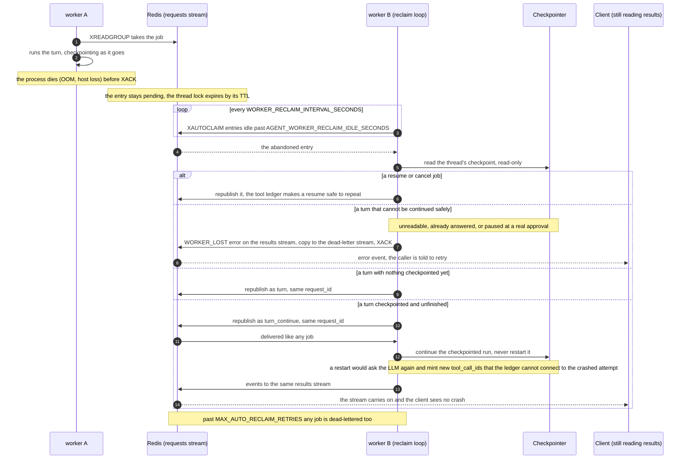

- **Continue, not restart** is what makes a crashed turn safe even after a write ran: passing no new input makes LangGraph resume the unfinished step and match writes already recorded instead of re-executing them (`app/agent/runtime/stream.py::astream_events_continue_turn`; the decision is `_classify_reclaimed_turn` in `app/adapters/inbound/workers/agent_worker.py`).
- **The conservative edge is deliberate**: a crash before the turn's own first message was checkpointed can look like the previous, finished turn and be dead-lettered. That is a false negative (a safe retry skipped), never a duplicate write.
- A graceful shutdown (SIGTERM) stops reading, lets in-flight jobs finish and ack, then closes the pools; only a hard kill leaves work for the reclaim loop.
- The ingest worker has the same loop, but a reclaimed ingest job is always safe to retry because point ids derive from content (diagram 16).

### 13. Retrieval: hybrid search under a tenant scope

The agent is given context before it reasons, and what it may see is decided by a scope the store enforces inside the query.

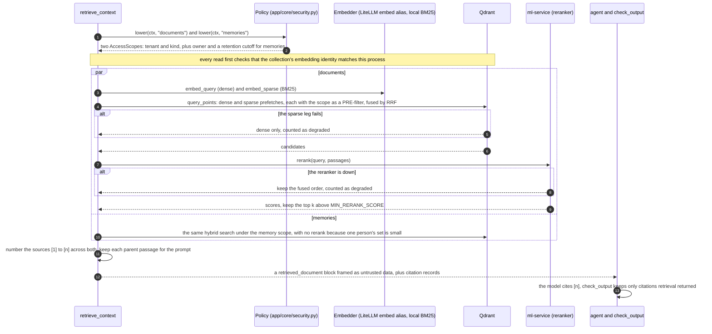

- **The scope is lowered once and applied in the query.** A Python post-filter looks identical to a correct one until a cross-tenant leak; `DocumentIndex.search` cannot be called without an `AccessScope`, and the unscoped lookup for the skills catalog is a separate, named method (`search_catalog`).
- **Documents are tenant-wide; memories are also scoped to their owner** and invisible after `MEMORY_RETENTION_DAYS`, enforced at read time (patterns 17, 18, 33). The two searches run concurrently, so the pre-fetch costs the slower of them.
- **Retrieval degrades, never fails the turn**: it is enrichment, and the model can still call `search_docs` itself. Each degrade is counted (`agent_retrieval_degraded_total`).
- Small child chunks are what is matched; their larger parent passage is what the model sees (pattern 24).

### 14. Cost: allowance, hold, metering, backstop

Every model call is priced and recorded in one place, the dollar caps sum those records, and a second stop sits outside the app in case the app's own checks are wrong.

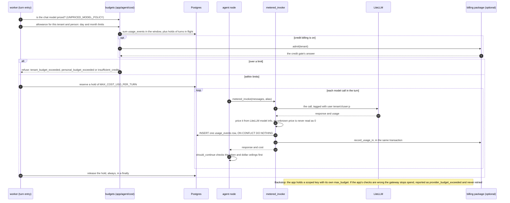

- **One choke point**: `metered_invoke` is the only place a chat-model call is made, priced and recorded, and `tests/agent/cost/test_metering_choke_point.py` fails on a new unmetered call. A call site that must remember to meter will one day forget.
- **The same rows serve the caps, `GET /usage`, the wallet and the export**, so what is capped and what is billed cannot disagree (pattern 58).
- **Holds keep concurrent turns honest**: without them, N turns starting together all read the same "spent so far". A hold ages out so a killed worker's cannot refuse real turns forever.
- **Fail policy is a decision**: a failed allowance read follows `BUDGET_CHECK_FAILURE_POLICY` (open by default, counted and alerted); a lost usage event pages.
- The billing half (rate, wallet, export outbox) is an independent package the app reaches through `app/billing_integration/port.py` (`BILLING_INTEGRATION.md`).

### 15. Delegation: skills and subagents

Both extend what one turn can do without growing the graph. A skill is instructions loaded on demand; a subagent is an isolated, read-only run whose answer comes back as a tool result.

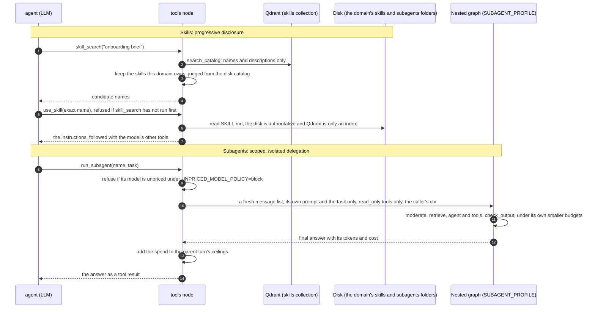

- A subagent never sees the conversation, uses a throwaway in-memory checkpointer, and inherits the `SecurityCtx` unconditionally. A last message that still carries tool calls is reported `budget_exceeded`, never passed on as an answer (pattern 46; `app/agent/tools/run_subagent.py::run_subagent_impl`).
- `skill_search` and `use_skill` sit first in a domain's tool list because a small model ignored them when they were last, whatever the prompt said (`app/agent/tools/builtin.py::skill_tools_first`).

### 16. Document ingestion

Upload only gets bytes into object storage and a job onto a queue of its own, separate from chat turns; parsing and embedding happen in the ingest worker.

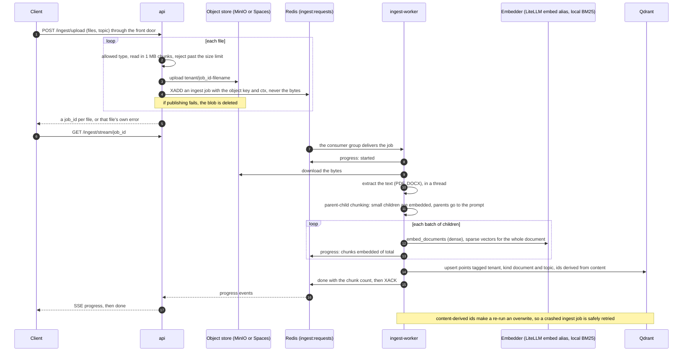

- The ingest queue and the turn queue are separate streams and consumer groups, so a burst of uploads cannot starve chat.
- A failure here is usually deterministic (a corrupt file), so the worker surfaces the error at once instead of retrying inside the same attempt.

### 17. MCP gateway

The same two read-only MCP servers, served over HTTP to clients that are not a child process of the person using them. The gateway is an OAuth 2.1 resource server: it checks tokens and never issues one.

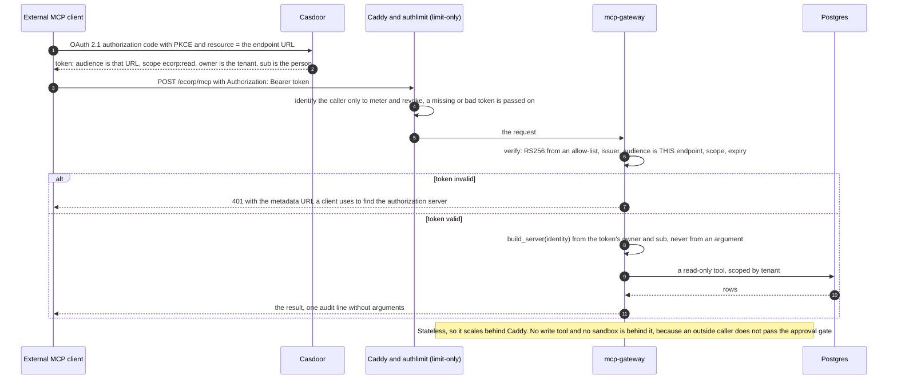

- **The identity is the token's**, never a tool argument or the launcher's environment. Over stdio (`make mcp-serve`) a server acts for its launcher's `MCP_TENANT` and `MCP_PRINCIPAL`; the gateway never reads those (patterns 78, 82).
- **The audience check is what stops a token minted for one resource being replayed at another.** A token without a `resource` parameter has the client id as its audience and is refused.
- The reverse direction, the agent consuming a remote MCP catalog, treats the remote as untrusted input: every remote tool defaults to `outward`, catalogs can be pinned by hash, and replies are scrubbed and bounded (pattern 28).

### 18. Process start: wire() and the graph

How the composition root turns "a Protocol with no implementation" into a running process, and why a mis-wired deploy stops at boot instead of failing the first request that needs the missing piece.

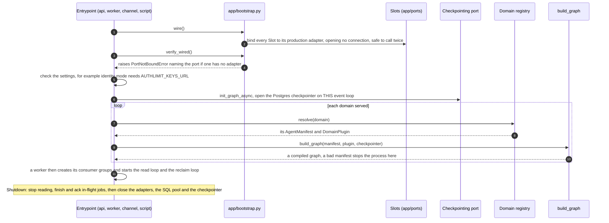

- **Slots are read at call time and bind once**: `ticket_store.get().get_ticket(...)`. Tests bind a fake with `Slot.overriding` (`tests/fakes/`); `tests/core/test_bootstrap.py` fails on a port without an adapter and on an adapter that does not match its Protocol.
- **The checkpointer is opened on the loop that will use it**: its lock binds to the event loop that created it, so every process awaits `init_graph_async()` on its own loop (pattern 16).
- A worker builds one graph per domain in `AGENT_WORKER_DOMAINS` (one name, a list, or `all`) under one concurrency budget, and the domain of a job is the stream it came from, never a field of the payload (pattern 96). The API builds its default domain's graph at start.

## Where to go next

| For | Read |
|---|---|
| The layering rules, the port catalogue, how to add a port, a domain or a way in | [ARCHITECTURE.md](ARCHITECTURE.md) |
| Every graph pattern, each with the bug that motivated it, and what is not built | [GRAPH_PATTERNS.md](GRAPH_PATTERNS.md) |
| Spend, caps and the gateway backstop | [COST_GOVERNANCE.md](COST_GOVERNANCE.md) |
| Sizing the worker pools and the connection budget | [WORKER_CONCURRENCY.md](WORKER_CONCURRENCY.md) |
| The edge service: failure policy, route classes, key rotation | [services/authlimit/README.md](services/authlimit/README.md) |
| The billing package and its seam | [BILLING_INTEGRATION.md](BILLING_INTEGRATION.md) |
| Running, deploying and operating it | [README.md](README.md), [deploy/README.md](deploy/README.md) |
| The rules a change must keep | [constitution](.specify/memory/constitution.md), [CLAUDE.md](CLAUDE.md) |
